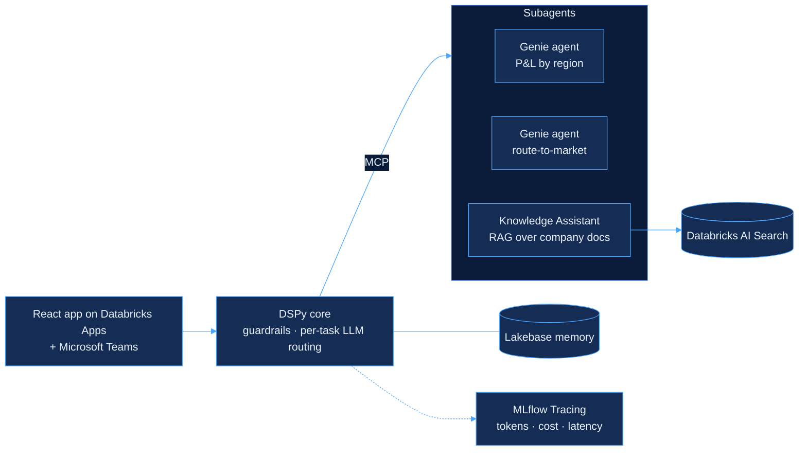

  

I'm an AI/ML engineer at **Arkon Data**, building LLM agents, RAG systems and ML pipelines that run in production, from raw data through training, deployment and monitoring. I came to GenAI from embedded systems, robotics and quant development, so I care about what happens after the demo: guardrails, latency, token cost and observability.

  

## Flagship: a finance multi-agent system

Financial analysts in more than 40 countries use it to pull income statements and drill into the products, entities and drivers that move results the most. A DSPy core applies input and output guardrails and routes each task to the right LLM, then hands work to region-specific Genie agents and a Knowledge Assistant over MCP. It runs on Databricks Model Serving, behind a React app and Microsoft Teams.

The code belongs to a client, so the repository is private. The architecture above is the part I can share.

## More in production

<b>Sales forecasting and product cannibalization</b> · retail/CPG

 

- Owned the whole data science workflow on the client's Databricks data, from EDA and feature engineering to training and evaluation, to forecast sales across a bakery product portfolio.
- Modeled which products eat into each other's sales, to guide assortment and demand planning.
- Served the model from a Databricks Model Serving endpoint that an LLM agent in Microsoft Teams calls for predictions and cannibalization analysis on demand.

**Stack:** Python, scikit-learn, MLflow, Databricks Model Serving

<b>Plant maintenance RAG assistant</b> · industrial bakery

 

- Built the RAG system behind an iPad assistant that answers failure-code, maintenance and operating questions from ingested machine manuals, citing the source of every answer.
- Owned retrieval and generation on the client's Azure, delivered alongside Microsoft engineers.

**Stack:** Microsoft Foundry, Azure AI Search, Python

## How I got here

  

Since 2023 I've also taught AI, software and embedded systems at Universidad La Salle Bajío, in both bachelor's and master's programs.

## Stack

  

  

## Certifications

  
  

AI brand icons from <a href="https://github.com/lobehub/lobe-icons">Lobe Icons</a>; other logos from <a href="https://simpleicons.org">Simple Icons</a>. Images are generated by <code>scripts/build-assets.mjs</code>.
