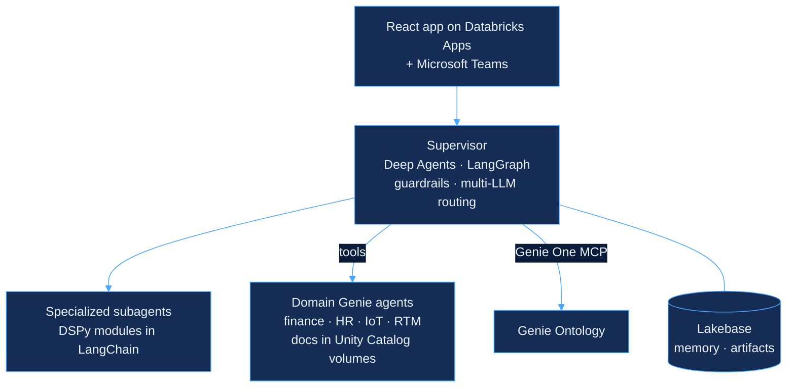

  

I'm an AI/ML engineer building LLM agents, RAG systems and ML pipelines that run in production on Databricks and on self-hosted infrastructure, from raw data through training, deployment and monitoring. I came to GenAI from embedded systems, robotics and quant development, so I care about what happens after the demo: guardrails, latency, token cost, security and observability.

  

## Flagship: an enterprise multi-agent system

It started as a finance assistant and grew into a company-wide data assistant. Analysts in more than 40 countries use it to pull income statements and drill into the products, entities and drivers that move results the most, and it now connects people/HR, IoT and route-to-market data with company documents too.

A Deep Agents/LangGraph supervisor delegates to specialized subagents, including DSPy modules wrapped in LangChain, with guardrails and per-task routing across several LLMs on Model Serving. Its tools are domain Genie agents over tables and Unity Catalog volumes, plus Genie Ontology through the Genie One MCP server. It runs as a Databricks App on the client's Azure Databricks: a React UI streams each subagent's events and renders Plotly charts, DataFrames, code and cited documents, with Lakebase holding memory and artifacts, and Microsoft Teams as a second front door.

The code belongs to a client, so the repository is private. The architecture above is the part I can share.

## More in production

<b>Self-hosted AI platform infrastructure</b> · zero trust, infrastructure as code

 

- Built, on my own, the self-hosted platform behind a company's AI services, used by every team: servers with no inbound ports, cloud resources in OpenTofu and idempotent host configuration in Ansible.
- Published internal MCP servers to Claude connectors through Cloudflare Tunnel, with Cloudflare Access as their OAuth server, while the Coolify control panel and a private container registry stay reachable only over the Tailscale tailnet.
- Secured the stack with SOPS/age-encrypted secrets, client-side encrypted remote state, three exposure tiers (private, protected, public), host hardening, encrypted nightly backups and uptime monitoring.
- Gated every release tag on a verified, empty infrastructure plan, so each tag is a tested restore point.

**Stack:** OpenTofu, Ansible, Coolify, Hetzner, Tailscale, Cloudflare Tunnel and Access, SOPS/age, Docker

<b>Sales forecasting and product cannibalization</b> · retail/CPG

 

- Owned the whole data science workflow on the client's Azure Databricks data, from EDA and feature engineering to training and evaluation, to forecast sales across a bakery product portfolio.
- Modeled which products eat into each other's sales, to guide assortment and demand planning.
- Served the model from a Databricks Model Serving endpoint that an LLM agent in Microsoft Teams calls for predictions and cannibalization analysis on demand.

**Stack:** Python, scikit-learn, MLflow, Azure Databricks Model Serving

<b>Plant maintenance RAG assistant</b> · industrial bakery

 

- Built the RAG system behind an iPad assistant that answers failure-code, maintenance and operating questions from ingested machine manuals, citing the source of every answer.
- Owned retrieval and generation on the client's Azure, using a Microsoft Foundry and Azure AI Search vector index.

**Stack:** Microsoft Foundry, Azure AI Search, Python

## How I got here

  

Since 2023 I've also been a university professor, teaching AI, software, electronics and embedded systems in bachelor's and master's programs.

## Stack

  

  

## Certifications

  
  

AI brand icons from <a href="https://github.com/lobehub/lobe-icons">Lobe Icons</a>; other logos from <a href="https://simpleicons.org">Simple Icons</a>. Images are generated by <code>scripts/build-assets.mjs</code>.
